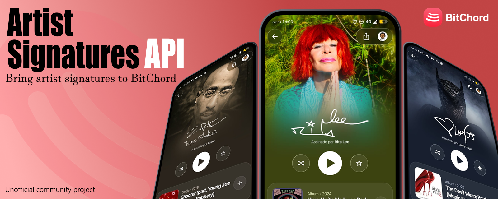
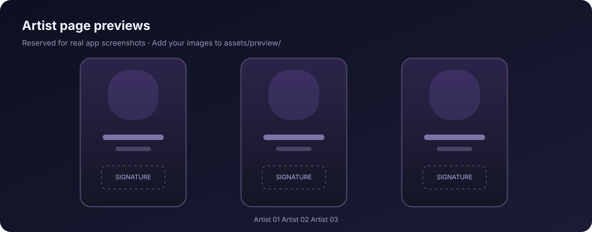
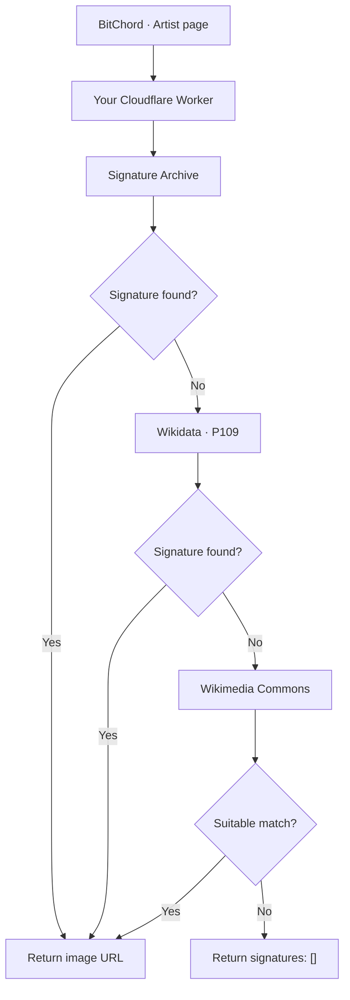

<div align="center">



<br />

# Artist Signatures API

### Bring artist signatures to BitChord.

An independent, self-hosted API that discovers artist-signature images from public sources and returns them in a format compatible with **BitChord v1.8.1+**.

<br />

[](https://workers.cloudflare.com/)
[](src/worker.js)
[](LICENSE)

**[Preview](#preview) · [Features](#features) · [Quick Start](#quick-start) · [API](#api-reference) · [Credits](#credits)**

[**🇧🇷 Português**](docs/INSTALL.pt-BR.md)

</div>

> [!NOTE]
> Independent community project. Compatible with [BitChord](https://github.com/kushagrasinghx/BitChord), but **not affiliated with, sponsored by, or endorsed by** BitChord or its developers.

---

## Preview

<div align="center">
  
  <sub>Visual placeholders — real BitChord artist-profile screenshots will replace these images.</sub>
</div>

<!-- Replace placeholders later:
1. Put the finished banner at assets/banner.png and point the first  to it.
2. Put your artist screenshots in assets/preview/ and replace the gallery image above.
3. Keep attribution notes for app UI and image credits in docs/SOURCES.md.
-->

---

## Features

<table>
<tr>
<td width="50%" valign="top">

### Artist signatures
Add a personal touch to artist pages using existing signature images. Missing matches return an empty list rather than a fabricated signature.

### Self-hosted
Each person deploys their **own instance**, keeping the service independent of the maintainer's Cloudflare account and quota.

</td>
<td width="50%" valign="top">

### Multiple sources
Combines [Signature Archive](https://github.com/itsmeadarsh2008/signature-archive), [Wikidata P109](https://www.wikidata.org/wiki/Property:P109) and Wikimedia Commons lookups.

### Lightweight setup
One Worker file, no npm dependencies at runtime, and no BitChord, SoundCloud or Spotify account credentials required.

</td>
</tr>
</table>

---

## Quick Start

<div align="center">

### Run your own API in a few minutes

[](https://dash.cloudflare.com/)
[](src/worker.js)

</div>

1. Open **[Cloudflare Workers & Pages](https://dash.cloudflare.com/)** and create a Worker using **Start with Hello World**.
2. Choose your Worker name, then select **Deploy**.
3. Select **Edit code**, replace the example with [**src/worker.js**](src/worker.js), and **Deploy** again.
4. Open `https://YOUR-WORKER.workers.dev/v1/health`. The JSON response should contain `"ok": true`.
5. In BitChord, go to **Settings → Artist Signatures**, enable it and paste your **Worker base URL** into the signature API URL field.

<table>
<tr><td align="center" width="50%"><strong>1 — Test your Worker</strong></td><td align="center" width="50%"><strong>2 — Paste the base URL into BitChord</strong></td></tr>
<tr><td><pre>https://YOUR-WORKER.workers.dev/v1/health</pre></td><td><pre>https://YOUR-WORKER.workers.dev</pre></td></tr>
</table>

> [!TIP]
> **Use your own Worker URL.** No shared public endpoint is required, and you do not need to provide passwords, API keys or login credentials. Cloudflare's free-plan limits still apply.

Need help? Read the [Portuguese setup guide](docs/INSTALL.pt-BR.md) or the [English deployment details](docs/README.en.md).

---

## How it works



Results depend on upstream availability. **These images are not authenticated autographs**; automatic matching can be incomplete or incorrect.

---

## API Reference

| Endpoint | Purpose |
| :--- | :--- |
| `GET /v1/health` | Service availability check |
| `GET /v1/signatures?artist=2Pac` | Find candidate signature images for an artist |
| `GET /v1/catalog` | Pre-indexed entries only; not every dynamically searchable artist |
| `GET /` | API metadata |

<details>
<summary><strong>Example JSON response</strong> — click to expand</summary>

```json
{
  "artist": "2Pac",
  "signatures": [
    {
      "artist": "2Pac",
      "asset": {
        "url": "https://raw.githubusercontent.com/itsmeadarsh2008/signature-archive/main/assets/2Pac.png",
        "format": "png"
      },
      "verification": "unverified"
    }
  ]
}
```

The example is illustrative. Actual results may include source and licensing metadata, and may change as external catalogs change.
</details>

<details>
<summary><strong>Local development and tests</strong></summary>

Requires Node.js 22+ for the optional test command:

```bash
npm test
```

The tests mock upstream services; they do not test your Cloudflare account or the live Wikimedia services.

```text
src/worker.js                 Cloudflare Workers API
assets/banner-placeholder.svg Temporary header illustration
assets/preview-placeholder.svg Temporary screenshot layout
docs/README.en.md             English setup details
docs/INSTALL.pt-BR.md         Brazilian Portuguese guide
docs/SOURCES.md               Credits and image-rights notes
tests/smoke.mjs               Local smoke checks
LICENSE                       MIT license for project code
```
</details>

---

## Credits

<div align="center">

| Project | Role |
| :--- | :--- |
| [**BitChord**](https://github.com/kushagrasinghx/BitChord) | Compatible music app and inspiration for presentation |
| [**Signature Archive**](https://github.com/itsmeadarsh2008/signature-archive) | Community artist-signature index |
| [**Wikidata**](https://www.wikidata.org/) | Structured entity data and P109 |
| [**Wikimedia Commons**](https://commons.wikimedia.org/) | Image hosting and file-level license metadata |

</div>

Developed with assistance from **ChatGPT (OpenAI)**. This is not an official partnership or endorsement.

**Code:** [MIT License](LICENSE). **Images:** each upstream file has separate rights and licensing requirements. Refer to [Sources & image rights](docs/SOURCES.md) before redistributing images. Signatures returned by this API may be unverified.

---

<div align="center">

**Maintained by [PandaFron-t](https://github.com/PandaFron-t)**

<sub>Independent project · Not affiliated with BitChord, Wikimedia, the artists, or OpenAI</sub>

</div>
